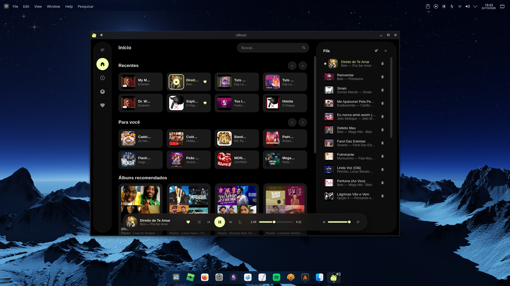

<div align="center">


# cMusic

**YouTube Music as a native Linux desktop player.** No login, no browser, no fuss.

[Electron](https://www.electronjs.org/) (UI) + [Python](https://www.python.org/) (FastAPI · `ytmusicapi` · `yt-dlp`)


</div>

---

## Screenshot

<div align="center">

<p><em>Home with queue sidebar and Dynamic Island</em></p>
</div>

<!-- more screenshots: uncomment and drop the PNGs into assets/ -->
<!-- <table><tr><td></td><td></td></tr></table> -->

---

## What it does

- **Play YouTube Music** in a real player: search, home with recommendations, radio/similar tracks, albums and playlists — with **audio streaming** via `yt-dlp`
- **Native-app-style UI:** collapsible sidebar, side queue and a floating **Dynamic Island** (glassmorphism) with controls, seek and volume
- **Instant mix:** clicking a track builds the queue with ~20 similar tracks automatically
- **Favorites and history** stored locally (localStorage) — **no login, no Google account**
- **KDE/Plasma integration (MPRIS):** current track with cover shows up in the system media widget; multimedia keys (play/pause/next/previous) control the player
- **Keyboard shortcuts:** Space · Left/Right · Up/Down · N · P · Ctrl+F

## Layout

| Region | Content |
|--------|----------|
| **Left sidebar** | Similar · Albums · Favorites (collapsible) |
| **Center** | Home (Recent · For you · Albums), Search (Songs / Albums), Album (with back button), Favorites |
| **Right queue** | Current track + upcoming, clickable, removable, clear all |
| **Dynamic Island** | Floating player: cover, title, controls, progress and volume |

## Installation

```bash
cd cMusic
./setup.sh          # creates the Python .venv and installs dependencies
```

### Installed app (KDE launcher)

`./setup.sh install` does **not** install a copy of the app — it only creates launchers
that run the project straight from this folder:

- Icon at `~/.local/share/icons/hicolor/512x512/apps/cmusic.png`
- Wrapper `~/.local/bin/cmusic` → `cd` into the repo and run `npm start`
- Menu entry `~/.local/share/applications/cmusic.desktop`

**Updates are automatic:** edits/pulls in this repo are picked up on the next launch —
just open **cMusic** from the KDE menu (or run `cmusic`). No reinstall needed.

Re-run `./setup.sh` only when dependencies change (requirements/npm). Re-run
`./setup.sh install` only to refresh the icon/shortcut. If you move or delete this
folder, the menu entry breaks — run `./setup.sh install` again to regenerate it.

## Usage

```bash
npm start           # Electron: starts the Python backend and the window together
```

Backend only (plain browser instead of Electron):

```bash
.venv/bin/python backend/server.py   # → http://127.0.0.1:8377
```

> **Age-restricted videos:** export your YouTube cookies to `cookies.txt` in the project root (or use `YTMUSIC_COOKIES=/path/cookies.txt`). Without it, those tracks are skipped automatically with a toast.
>
> **Planned:** native cookies-from-browser support (`YTMUSIC_COOKIES_FROM_BROWSER=firefox|chrome`) and a `./setup.sh cookies` command to export the file in one step.

## API

Anonymous FastAPI backend: `health`, `search`, `explore/home`, `related`, `album` and `stream` (audio resolving). Details in `backend/cmusic/`.

## Project structure

```
cMusic/
├── electron/main.js          # Electron process: starts backend + window
├── backend/
│   ├── server.py             # entrypoint (builds the app package)
│   └── cmusic/               # package: config, client, tracks,
│                             #   search, stream, explore, collection
├── src/
│   ├── index.html
│   ├── assets/               # icon served to the frontend
│   ├── css/                  # base · layout · components · animations
│   └── js/                   # ES modules:
│       ├── main.js           #   boot, sidebar, search, shortcuts
│       ├── state.js          #   shared mutable state
│       ├── utils.js          #   helpers ($, toast, fmtTime…)
│       ├── api.js            #   backend routes
│       ├── store.js          #   history and favorites (localStorage)
│       ├── island.js         #   player/island and audio controls
│       ├── queue.js          #   side queue
│       ├── player.js         #   instant mix
│       ├── views.js          #   content router (back button lives here)
│       └── components/       #   templates.js (pure render)
└── .venv/                    # Python environment
```

## Controls

Click a track → mix · `+` queues it · click a queue item to play · "←" button goes back ·
**Space** play/pause · **← →** seek · **↑ ↓** volume · **N** next · **P** previous · **Ctrl+F** search (input expands)

## License

MIT
